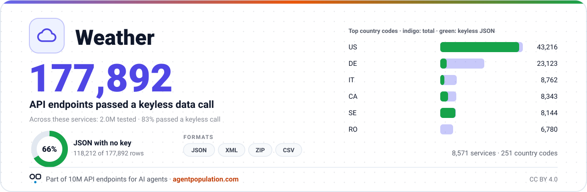
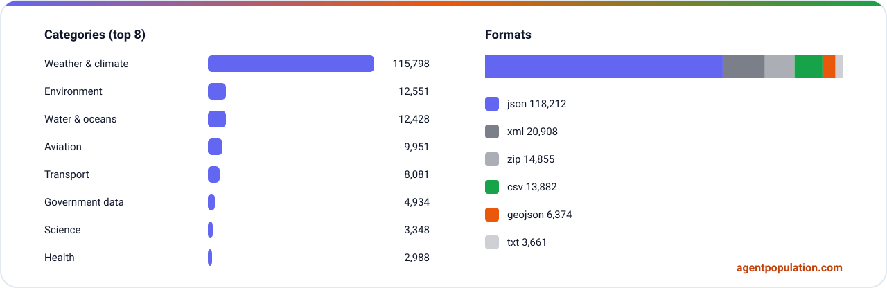

<p align="center"></p>

# 🌦️ Weather API endpoints

**177,892 weather API endpoints that answered a keyless GET with a data body. For agent and app builders.**

<p align="center"><a href="#files"></a> <a href="#columns-and-tags"></a> <a href="#whats-inside"></a> <a href="#whats-inside"></a> <a href="LICENSE"></a></p>

<p align="center"><a href="#whats-in-it-for-you">What's in it</a> · <a href="#for-ai-agents">For AI agents</a> · <a href="#quick-start">Quick start</a> · <a href="#test-it-yourself">Test it yourself</a> · <a href="#files">Files</a> · <a href="#licence-and-credit">Licence</a> · <a href="#part-of-10m-api-endpoints-for-ai-agents">More packs</a></p>

This repository holds a 1,000-row sample and the services list; the full list of 177,892 endpoints is one download from the [latest release](https://github.com/agentpopulation/170k-weather-apis-for-agents/releases/latest).

**Endpoints for building a weather agent or app.** Forecasts by point, station observations, airport weather (METAR and TAF), air quality and climate series, as URLs that answered with no key on their test date.

Selection rule: rows where `tags has weather OR tags has forecast OR tags has climate OR tags has air-quality`, less the rows that a leave-out rule drops (each counted under Known limits).

98,051 of these 177,892 rows match the focus rule (below); the others are in the pack by the selection rule only, and Known limits says what they are. 29,027 rows (16.3%) are map layers on ArcGIS Online, where anyone can publish.

## In plain words

**What is an API endpoint?** An API endpoint is one web address that a program can ask for data, for example the latest reading at one weather station. A single service, such as a national weather agency, can have thousands of endpoints: one per station, city or dataset. This pack counts endpoints, not separate services.

**What does "passed a data call" mean?** On the date shown in each row, AgentPopulation sent one plain request to that address, with no password or key, and got a non-empty data body back (JSON, CSV, XML or a file): not an error page and not an empty result. Some bodies describe a dataset rather than hold its values; see Known limits. It shows the address answered with data on that day. It is not a promise that it answers today, and licences and usage limits were not reviewed.

## What's in it for you

Four ways to use this pack. Each bucket gives a count, a filter you can apply to the CSV, one example that passed, and a list of recommended starting points with the rule that picked them. Buckets overlap; a row can fit more than one.

Examples, recommended lists and the preview are drawn from rows that match this pack's focus rule, so a row that a tag put in this pack but that is about something else is not shown as a starting point. Counts cover the whole bucket.

<details>
<summary>The focus rule</summary>

Focus rule: `category in ("Weather & Climate", "Aviation", "Environment", "Hazards") AND NOT title matches /parking|occupancy|jobs|dwelling|household|housing|population|powergrid|employment|floor space|small area/i AND title matches /\b(weather|forecast|climat|temperat|rain|precip|wind|air quality|air-quality|pm2|pm10|ozone|metar|taf|aerodrome|meteo|météo|wetter|observation|snow|humidity|storm|station)/i`

</details>

### 🤖 Agent tools: Forecast and airport-weather tools an agent can call

**17,500** endpoints from 330 services · Wrap one URL pattern as a get_forecast tool: pass a place or airport code, return the next hours; add a timeout and a fallback.

Start with: `tags has agent-ready AND tags has forecast AND category in ("Weather & Climate", "Aviation") AND NOT url contains "/erddap/info/"`

Example: [MET Norway forecast: Kellé, Congo](https://api.met.no/weatherapi/locationforecast/2.0/compact?lat=-0.065&lon=14.5) · MET Norway (api.met.no) · passed 2026-11-14

<details>
<summary>Recommended starting points: 8 services, picked by the stated criteria inside</summary>

**Recommended starting points.** Selected by stated criteria, not a ranking of quality: Services in this pack with the most endpoints that match this bucket and are tagged `agent-ready` (no key sent in the test call, JSON body, passed a data call). Ties go to the service with more country codes, then by name. Only services with at least one bucket row that matches the focus rule are listed, and the sample comes from those rows; the counts cover the whole bucket. The sample URL is the first row by URL sort after preferring, in this order: rows that match the bucket's sample preference when it has one, rows that return values rather than describe a dataset or a service (not ERDDAP /info/ pages, OGC GetCapabilities requests, bare OWS addresses, PxWeb tables, UN SDG series lists, Statistics Canada download pointers, WorldPop listings, GTFS validation reports, untitled rows or service root addresses), and agent-ready rows. Sample preference in this bucket: `title matches /forecast/i`. Services named "ArcGIS organization" hold map layers from many owners and are added only when fewer than 5 other services match.

| Service (host) | Endpoints in bucket | In pack | Country codes in bucket | Formats in bucket | Sample URL that passed |
|---|---:|---:|---|---|---|
| MET Norway (api.met.no) | 8,757 | 10,029 | 242 codes | json | [MET Norway forecast: Kellé, Congo](https://api.met.no/weatherapi/locationforecast/2.0/compact?lat=-0.065&lon=14.5) (2026-11-14) |
| US Aviation Weather Center (aviationweather.gov) | 3,150 | 9,612 | 225 codes | json | [TAF forecast: Honiara/Henderson Arpt (A…](https://aviationweather.gov/api/data/taf?ids=AGGH&format=json) (2026-11-14) |
| Open-Meteo weather API (api.open-meteo.com) | 1,752 | 1,753 | 242 codes | json | [Open-Meteo 7-day forecast: Kisumu, Kenya](https://api.open-meteo.com/v1/forecast?latitude=-0.102&longitude=34.762&hourly=temperature_2m,precipitation,wind_speed_10m&daily=temperature_2m_max,temperature_2m_min,precipitation_sum&timezone=auto&forecast_days=7) (2026-11-14) |
| Bmkg (api.bmkg.go.id) | 996 | 996 | ID | json | [BMKG (Badan Meteorologi, Klimatologi, d…](https://api.bmkg.go.id/publik/prakiraan-cuaca?adm4=11.01.01.2002) (2026-11-15) |
| Wmo (worldweather.wmo.int) | 887 | 887 | 114 codes | json | [WMO World Weather (national met service…](https://worldweather.wmo.int/en/json/1000_en.json) (2026-11-14) |
| Environment and Climate Change Canada GeoMet/MSC (api.weather.gc.ca) | 844 | 4,254 | CA | json | [Air Quality Health Index Forecasts - MS…](https://api.weather.gc.ca/collections/aqhi-forecasts-realtime) (2026-11-15) |
| Jma (www.jma.go.jp) | 111 | 169 | JP | json | [JMA forecast: Soya](https://www.jma.go.jp/bosai/forecast/data/forecast/011000.json) (2026-11-14) |
| Lombardia (www.dati.lombardia.it) | 66 | 173 | IT | json | [ISTAT Residents Forecast Central Scenar…](https://www.dati.lombardia.it/api/views/5z96-gndh/rows.json?accessType=DOWNLOAD) (2026-11-14) |

</details>

### 📱 App features: Weather cards, air-quality widgets, station maps, airport weather

**65,386** endpoints from 7,551 services · Show current conditions, air quality and airport weather on a card or a station map.

Start with: `tags has air-quality OR tags has maps OR url contains "aviationweather.gov/api/data/metar"`

Example: [METAR: Honiara/Henderson Arpt (AGGH)](https://aviationweather.gov/api/data/metar?ids=AGGH&format=json) · US Aviation Weather Center · passed 2026-11-14

<details>
<summary>Recommended starting points: 8 services, picked by the stated criteria inside</summary>

**Recommended starting points.** Selected by stated criteria, not a ranking of quality: Services in this pack with the most endpoints that match this bucket and passed a data call. Ties go to the service with more country codes, then by name. Only services with at least one bucket row that matches the focus rule are listed, and the sample comes from those rows; the counts cover the whole bucket. The sample URL is the first row by URL sort after preferring, in this order: rows that match the bucket's sample preference when it has one, rows that return values rather than describe a dataset or a service (not ERDDAP /info/ pages, OGC GetCapabilities requests, bare OWS addresses, PxWeb tables, UN SDG series lists, Statistics Canada download pointers, WorldPop listings, GTFS validation reports, untitled rows or service root addresses), and agent-ready rows. Services named "ArcGIS organization" hold map layers from many owners and are added only when fewer than 5 other services match.

| Service (host) | Endpoints in bucket | In pack | Country codes in bucket | Formats in bucket | Sample URL that passed |
|---|---:|---:|---|---|---|
| data.gov.ro | 6,640 | 6,706 | RO | xml | [List of uncertified measurements (UTD) …](https://data.gov.ro/dataset/02be02cc-d560-4654-a163-bd5f6a5fb41a/resource/00949de1-66bf-416a-8743-248cf3922438/download/statia-ro0115a-valori-nevalidate-aferente-lunii-februarie-anul-2015.xml) (2026-11-15) |
| US Aviation Weather Center (aviationweather.gov) | 5,542 | 9,612 | 226 codes | json | [METAR: Honiara/Henderson Arpt (AGGH)](https://aviationweather.gov/api/data/metar?ids=AGGH&format=json) (2026-11-14) |
| Open-Meteo air quality API (air-quality-api.open-meteo.com) | 1,043 | 1,043 | 242 codes | json | [Open-Meteo air quality: Quito, Ecuador](https://air-quality-api.open-meteo.com/v1/air-quality?latitude=-0.23&longitude=-78.52&current=pm10,pm2_5,us_aqi) (2026-11-14) |
| Defra (uk-air.defra.gov.uk) | 1,015 | 1,015 | GB | json | [UK-AIR (Defra) air quality: Bristol St …](https://uk-air.defra.gov.uk/sos-ukair/api/v1/timeseries/100) (2026-11-14) |
| Airgradient (api.airgradient.com) | 996 | 996 | 66 codes | json | [AirGradient: Current air quality: Romil…](https://api.airgradient.com/public/api/v1/world/locations/102812/measures/current) (2026-11-15) |
| Fmi (opendata.fmi.fi) | 842 | 842 | FI | xml, json | [FMI point forecast: Kemi Ajos](https://opendata.fmi.fi/wfs?service=WFS&version=2.0.0&request=getFeature&storedquery_id=fmi::forecast::harmonie::surface::point::simple&fmisid=100539) (2026-11-14) |
| Gios (api.gios.gov.pl) | 805 | 805 | PL | json | [GIOŚ (Chief Inspectorate of Environment…](https://api.gios.gov.pl/pjp-api/v1/rest/aqindex/getIndex/10005) (2026-11-15) |
| www.umweltbundesamt.de | 804 | 805 | DE | csv, json | [Particulate matter (PM10) Bornhöved Dai…](https://www.umweltbundesamt.de/api/air_data/v2/measures/json?station=1535&component=1&scope=1&date_from=2017-01-01&time_from=1&date_to=2017-12-31&time_to=24&lang=de) (2026-11-14) |

</details>

### 🧠 Grounding and data pipelines: Climate and observation series for RAG, dashboards and notebooks

**65,260** endpoints from 2,112 services · Load climate and observation series on a schedule into your own store for RAG, dashboards and notebooks.

Start with: `tags has climate OR format in (csv, zip, xml)`

Example: [DWD 10-min temperature (now) station 00044](https://opendata.dwd.de/climate_environment/CDC/observations_germany/climate/10_minutes/air_temperature/now/10minutenwerte_TU_00044_now.zip) · Deutscher Wetterdienst Open Data · passed 2026-11-14

<details>
<summary>Recommended starting points: 8 services, picked by the stated criteria inside</summary>

**Recommended starting points.** Selected by stated criteria, not a ranking of quality: Services in this pack with the most endpoints that match this bucket and passed a data call. Ties go to the service with more country codes, then by name. Only services with at least one bucket row that matches the focus rule are listed, and the sample comes from those rows; the counts cover the whole bucket. The sample URL is the first row by URL sort after preferring, in this order: rows that match the bucket's sample preference when it has one, rows that return values rather than describe a dataset or a service (not ERDDAP /info/ pages, OGC GetCapabilities requests, bare OWS addresses, PxWeb tables, UN SDG series lists, Statistics Canada download pointers, WorldPop listings, GTFS validation reports, untitled rows or service root addresses), and agent-ready rows. Sample preference in this bucket: `title matches /climat|observation|station|precipitation|temperature/i`. Services named "ArcGIS organization" hold map layers from many owners and are added only when fewer than 5 other services match.

| Service (host) | Endpoints in bucket | In pack | Country codes in bucket | Formats in bucket | Sample URL that passed |
|---|---:|---:|---|---|---|
| Deutscher Wetterdienst Open Data (opendata.dwd.de) | 14,761 | 14,761 | DE | zip, csv, txt | [DWD 10-min temperature (now) station 00…](https://opendata.dwd.de/climate_environment/CDC/observations_germany/climate/10_minutes/air_temperature/now/10minutenwerte_TU_00044_now.zip) (2026-11-14) |
| data.gov.ro | 6,706 | 6,706 | RO | xml, csv | [List of uncertified measurements (UTD) …](https://data.gov.ro/dataset/02be02cc-d560-4654-a163-bd5f6a5fb41a/resource/00949de1-66bf-416a-8743-248cf3922438/download/statia-ro0115a-valori-nevalidate-aferente-lunii-februarie-anul-2015.xml) (2026-11-15) |
| Nasa (power.larc.nasa.gov) | 3,600 | 3,601 | 186 codes | json | [NASA POWER climatology (temp, rain, sol…](https://power.larc.nasa.gov/api/temporal/climatology/point?parameters=T2M,PRECTOTCORR,ALLSKY_SFC_SW_DWN,WS2M&community=RE&longitude=-0.035&latitude=5.7&format=JSON) (2026-11-14) |
| Ireland Open Data Portal (clidata.met.ie) | 2,471 | 2,471 | IE | txt | [Dungarvan (Carriglea) Climate Data](https://clidata.met.ie/cli/climate_data/webdata/dly1407.csv) (2026-11-15) |
| Admin (data.geo.admin.ch) | 1,278 | 1,325 | CH | csv, json, geojson, zip | [Climate stations - Homogeneous data ser…](https://data.geo.admin.ch/ch.meteoschweiz.ogd-nbcn/ogd-nbcn_meta_datainventory.csv) (2026-11-14) |
| Environment and Climate Change Canada GeoMet/MSC (api.weather.gc.ca) | 1,192 | 4,254 | CA | geojson, json | [Monthly Climate Observation Summaries -…](https://api.weather.gc.ca/collections/climate-monthly/items) (2026-11-15) |
| Usgs (data.usgs.gov) | 1,025 | 1,025 | US | xml | [Isohyetal map showing distribution of a…](https://data.usgs.gov/datacatalog/metadata/USGS.005376c2-9bf7-44c0-94d0-43deebc5e30f.xml) (2026-11-15) |
| Bmkg (api.bmkg.go.id) | 996 | 996 | ID | json | [BMKG (Badan Meteorologi, Klimatologi, d…](https://api.bmkg.go.id/publik/prakiraan-cuaca?adm4=11.01.01.2002) (2026-11-15) |

</details>

### 🧪 Evals and testing: Varied responses to test tool calls and parsers

**177,892** endpoints · 8,571 services · 251 country codes · 6 formats · Run your tool calls against a fixed set of URLs across formats and record which answer; last_tested is the baseline for your own re-tests.

Start with: the whole pack

Example: [NOAA Aviation Weather Center: Airport info: Honia…](https://aviationweather.gov/api/data/airport?ids=AGGH&format=json) · US Aviation Weather Center · passed 2026-11-15

<details>
<summary>Recommended starting points: 8 services, picked by the stated criteria inside</summary>

**Recommended starting points.** Selected by stated criteria, not a ranking of quality: Services in this pack that returned the most different formats, then the most endpoints that passed a data call, then by name: a mix of response shapes to test parsers and tool calls. Only services with at least one bucket row that matches the focus rule are listed, and the sample comes from those rows; the counts cover the whole bucket. The sample URL is the first row by URL sort after preferring, in this order: rows that match the bucket's sample preference when it has one, rows that return values rather than describe a dataset or a service (not ERDDAP /info/ pages, OGC GetCapabilities requests, bare OWS addresses, PxWeb tables, UN SDG series lists, Statistics Canada download pointers, WorldPop listings, GTFS validation reports, untitled rows or service root addresses), and agent-ready rows. Services named "ArcGIS organization" hold map layers from many owners and are added only when fewer than 5 other services match.

| Service (host) | Endpoints in bucket | In pack | Country codes in bucket | Formats in bucket | Sample URL that passed |
|---|---:|---:|---|---|---|
| Портал відкритих даних (data.gov.ua) | 329 | 329 | UA | csv, json, xml, zip, txt | [Hourly concentrations and air quality i…](https://data.gov.ua/dataset/402d427f-f024-465a-97a9-5ed29f510015/resource/0ef1cf7d-b43d-44a9-8086-9176462e04fe/download/saveecobot_cities_pm25_and_aqi_pm25_2021.csv) (2026-11-15) |
| Public (download.data.public.lu) | 251 | 251 | LU | json, csv, xml, geojson, zip | [Administration de l'environnement: Air …](https://download.data.public.lu/resources/air-quality-geostatistical-interpolation/20261113-220157/lux-data-no2-1hour.json) (2026-11-15) |
| Napsgfoundation (prep-response-portal.napsgfoundation.org) | 152 | 152 | global or unknown | csv, geojson, json, xml, zip | [National Weather Service Wind Gust Fore…](https://prep-response-portal.napsgfoundation.org/api/download/v1/items/0bf37bd236e848cf8b4a6dc5b162c11a/geojson?layers=0) (2026-11-15) |
| Canadian Urban Data Catalogue (CUDC) (geoportal.gov.mb.ca) | 52 | 52 | CA | json, xml, csv, geojson, zip | [Forecasted Basin-Average Accumulated Pr…](https://geoportal.gov.mb.ca/api/download/v1/items/0e74476ac32744679ff1d6075dd7142e/geojson?layers=0) (2026-11-15) |
| data.gis.ny.gov | 50 | 50 | US | json, csv, zip, geojson, xml | [Municipal Storm Sewer System MS4 Extend…](https://data.gis.ny.gov/api/download/v1/items/23c13229b3ac47ffa176d1854471fb25/csv?layers=1) (2026-11-15) |
| ArcGIS Online: ACT Canopy Cover 2020 1m WESTON (actmapi-actgov.opendata.arcgis.com) | 32 | 32 | AU | json, csv, zip, geojson, xml | [ACTGOV Climate Refugia - CSV](https://actmapi-actgov.opendata.arcgis.com/api/download/v1/items/43f98345a3b74494935bab4f6e042ad8/csv?layers=0) (2026-11-15) |
| California Open Data Portal (gis.data.ca.gov) | 27 | 27 | US | json, csv, xml, geojson, zip | [Climate Vulnerability and Risk Assessme…](https://gis.data.ca.gov/api/download/v1/items/72a3d6e31fd34092a2a5ba63d2c35a21/geojson?layers=0) (2026-11-15) |
| Zenodo (zenodo.org) | 26 | 26 | DE, IT | csv, txt, zip, json, xml | [Korrigierte und ergänzte Anlagendaten g…](https://zenodo.org/records/17592701/files/goal100_mastr_wind_corrected_epsg_25832_2025_11_12.geojson?download=1) (2026-11-14) |

</details>

The same lists are in [recommended.json](recommended.json), ready for an agent to load.

## Questions an agent can answer with this pack

- What is the latest METAR at a given airport? Try [METAR: Honiara/Henderson Arpt (AGGH)](https://aviationweather.gov/api/data/metar?ids=AGGH&format=json) (US Aviation Weather Center, passed 2026-11-14).
- What does the point forecast say for a city over the next hours? Try [MET Norway forecast: Kellé, Congo](https://api.met.no/weatherapi/locationforecast/2.0/compact?lat=-0.065&lon=14.5) (MET Norway (api.met.no), passed 2026-11-14).
- What are the current PM2.5 and US AQI near a city? Try [Open-Meteo air quality: Quito, Ecuador](https://air-quality-api.open-meteo.com/v1/air-quality?latitude=-0.23&longitude=-78.52&current=pm10,pm2_5,us_aqi) (Open-Meteo air quality API, passed 2026-11-14).
- What did a Swedish weather station record over the last day? Try [SMHI weather: Lufttemperatur · Gustavsfors A](https://opendata-download-metobs.smhi.se/api/version/1.0/parameter/1/station/103100/period/latest-day/data.json) (SMHI open meteorological observations, passed 2026-11-14).

## What "passed a data call" means

> [!NOTE]
> On the date in `last_tested` (IST), one GET to the URL, sent with no key, returned HTTP 2xx and a non-empty data body. HTML pages and empty results did not pass. The `format` column records what came back. This is a test result for that date, not a promise that the URL answers today. Licences, terms, rate limits, accuracy and freshness were not reviewed. Endpoints are URLs, not separate APIs; many share one service. This pack was tested 10–15 Nov 2026; snapshot 15 Nov 2026.

## For AI agents

Start from keyless JSON endpoints (`agent-ready`). The code below loads `recommended.json` and calls the first recommended service in the Agent tools bucket, with a timeout (`node examples/agent-start.mjs --recommended`). With no argument, `node examples/agent-start.mjs` calls the most recently tested agent-ready row of the sample; pass a `.csv` or `.csv.gz` path to use that file instead. See [examples/agent-start.mjs](examples/agent-start.mjs).

```js
// Node 18+. Loads recommended.json (the local copy, or the raw file on GitHub) and calls one keyless JSON endpoint.
import fs from 'node:fs';

const RAW = 'https://raw.githubusercontent.com/agentpopulation/170k-weather-apis-for-agents/main/recommended.json';
const rec = fs.existsSync('recommended.json')
  ? JSON.parse(fs.readFileSync('recommended.json', 'utf8'))
  : await (await fetch(RAW)).json();

const pick = rec.buckets.find((b) => b.id === 'agent').services[0];
try {
  const res = await fetch(pick.sample_url, {
    headers: { 'User-Agent': 'agent-example/1.0' },
    signal: AbortSignal.timeout(15000),
  });
  console.log(pick.service, res.status, res.headers.get('content-type'));
  console.log((await res.text()).slice(0, 300));
} catch (err) {
  console.log(`did not answer now; last passed ${pick.sample_last_tested} (${err.message})`);
}
```

How an agent picks an endpoint:

1. Filter to `agent-ready` and your country or topic.
2. Prefer the newest `last_tested` and the larger services.
3. Call with a timeout and check the body before you use it.

## Quick start

The examples run against the sample in `data/` out of the box (1,000 rows). Each takes an optional path to a `.csv` or `.csv.gz` file instead.

```bash
git clone https://github.com/agentpopulation/170k-weather-apis-for-agents.git
cd 170k-weather-apis-for-agents
python examples/quickstart.py
node examples/quickstart.mjs
node examples/agent-start.mjs
```

Full list: download `Weather_API_Endpoints_AgentPopulation_Snapshot_2026-11-15.csv.gz` (177,892 rows, 6.7 MB) from [releases/latest](https://github.com/agentpopulation/170k-weather-apis-for-agents/releases/latest), then gunzip it and pass its path. The scripts also read the `.csv.gz` as it is.

```bash
gunzip Weather_API_Endpoints_AgentPopulation_Snapshot_2026-11-15.csv.gz
python examples/quickstart.py Weather_API_Endpoints_AgentPopulation_Snapshot_2026-11-15.csv
node examples/quickstart.mjs Weather_API_Endpoints_AgentPopulation_Snapshot_2026-11-15.csv
```

### curl

Quote the URL: some contain commas.

```bash
curl -sL "https://raw.githubusercontent.com/agentpopulation/170k-weather-apis-for-agents/main/data/Weather_API_Endpoints_AgentPopulation_Sample.csv" | head -n 4
curl -s --max-time 15 "https://api.met.no/weatherapi/locationforecast/2.0/compact?lat=-0.065&lon=14.5" | head -c 600
```

### Python

Standard library only: [examples/quickstart.py](examples/quickstart.py) reads the sample, or the path you pass, keeps agent-ready rows and calls the most recently tested one.

<details>
<summary>The code</summary>

```python
# Python 3, standard library only. Run from a clone of this repository:
#   python examples/quickstart.py [path]
# With no path it reads the sample in data/. Pass the full list from the latest release (.csv or .csv.gz) instead.
# Keeps agent-ready rows and calls the most recently tested one.
import csv
import gzip
import os
import re
import sys
import urllib.request

HERE = os.path.dirname(os.path.abspath(__file__))
path = sys.argv[1] if len(sys.argv) > 1 else os.path.join(HERE, "..", "data", "Weather_API_Endpoints_AgentPopulation_Sample.csv")
opener = gzip.open if path.endswith(".gz") else open
with opener(path, "rt", newline="", encoding="utf-8") as f:
    rows = list(csv.DictReader(f))

agent = [r for r in rows if "agent-ready" in r["tags"].split("|")]
# Newest test date first; URLs that describe a dataset or a service rather than return values go last.
DESCRIBES = re.compile(r"/erddap/info/|action-report\.json$|[?&]request=getcapabilities|/GeoArea/[^/?]+/List|getFullTableDownloadCSV|hub\.worldpop\.org", re.I)
agent.sort(key=lambda r: r["last_tested"], reverse=True)
agent.sort(key=lambda r: 1 if DESCRIBES.search(r["url"]) else 0)
print(len(rows), "rows,", len(agent), "agent-ready")
if not agent:
    sys.exit(0)

row = agent[0]
req = urllib.request.Request(row["url"], headers={"User-Agent": "agent-example/1.0"})
try:
    with urllib.request.urlopen(req, timeout=15) as res:
        body = res.read(1_000_000).decode("utf-8", "replace")
        print(res.status, res.headers.get("Content-Type"))
        print(body[:300])
except Exception as err:
    print(f"did not answer now; last passed {row['last_tested']} ({err})")
```

</details>

### JavaScript

Reads the sample as JSON because the CSV has quoted commas.

<details>
<summary>The code</summary>

```js
// Node 18+. Reads the sample as JSON (the CSV has quoted commas), local file first.
import fs from 'node:fs';

const FILE = 'data/Weather_API_Endpoints_AgentPopulation_Sample.json';
const rows = fs.existsSync(FILE)
  ? JSON.parse(fs.readFileSync(FILE, 'utf8'))
  : await (await fetch('https://raw.githubusercontent.com/agentpopulation/170k-weather-apis-for-agents/main/data/Weather_API_Endpoints_AgentPopulation_Sample.json')).json();

const row = rows.find((r) => r.tags.includes('agent-ready'));
const res = await fetch(row.url, { headers: { 'User-Agent': 'agent-example/1.0' }, signal: AbortSignal.timeout(15000) });
console.log(res.status, (await res.text()).slice(0, 300));
```

</details>

### Agent tools

[examples/agent-tools.json](examples/agent-tools.json) holds two tool definitions in the shape most tool-calling APIs accept (name, description, JSON Schema); rename `parameters` if yours uses another key. [examples/quickstart.mjs](examples/quickstart.mjs) implements them:

- `find_endpoints` searches the agent-ready rows of the list by words, country code (their format is json). When you load the tools of more than one pack, prefix the names (for example `weather_find_endpoints`) so they do not clash.
- `fetch_endpoint` calls one URL, **refuses any URL that is not in the list** and does not follow redirects. The allowlist is built from the CSV, so a URL injected into a prompt is refused.

The same two tools can sit behind an MCP server.

## Test it yourself

Re-test endpoints from the sample with the same rule: HTTP 2xx and a non-empty body that is not an HTML page. Node 18+, no packages.

```bash
node tools/test-endpoints.mjs
```

It tests the first 50 URLs and prints one line: tested, passed, did not pass. Options: a `.csv` or `.csv.gz` path (the full list from the release), `--limit 50`, `--timeout-ms 10000`, `--out results.csv`. The results file holds `url`, `status`, `passed`, `content_type`, `ms` and `checked_at`; a status of `timeout` or `error:<code>` means no HTTP answer came back. It is polite: GET only, no key sent, at most 4 requests in flight, one at a time per listed host, at least 1 second between requests to one listed host, and reading stops once 256 kB of a body is kept. Redirects are followed and may lead to another host. `results.csv` is in `.gitignore`.

## Preview

One row from each of the five largest services among rows that match the focus rule, services with rows that return values first.

| Title | Service | Country | Format | Tested | Link |
|---|---|---|---|---|---|
| DWD 10-min temperature (now) station 00044 | Deutscher Wetterdienst Open Data | DE | zip | 2026-11-14 | [opendata.dwd.de](https://opendata.dwd.de/climate_environment/CDC/observations_germany/climate/10_minutes/air_temperature/now/10minutenwerte_TU_00044_now.zip) |
| NOAA Aviation Weather Center: Airport info: Honiara/Henders… | US Aviation Weather Center | SB | json | 2026-11-15 | [aviationweather.gov](https://aviationweather.gov/api/data/airport?ids=AGGH&format=json) |
| MET Norway forecast: Kellé, Congo | MET Norway (api.met.no) | CG | json | 2026-11-14 | [api.met.no](https://api.met.no/weatherapi/locationforecast/2.0/compact?lat=-0.065&lon=14.5) |
| SMHI weather: Lufttemperatur · Gustavsfors A | SMHI open meteorological observations | SE | json | 2026-11-14 | [opendata-download-metobs.smhi.se](https://opendata-download-metobs.smhi.se/api/version/1.0/parameter/1/station/103100/period/latest-day/data.json) |
| NASA POWER climatology (temp, rain, solar, wind): Ashaiman,… | Nasa | GH | json | 2026-11-14 | [power.larc.nasa.gov](https://power.larc.nasa.gov/api/temporal/climatology/point?parameters=T2M,PRECTOTCORR,ALLSKY_SFC_SW_DWN,WS2M&community=RE&longitude=-0.035&latitude=5.7&format=JSON) |

Browse the 1,000-row sample: [Sample CSV](data/Weather_API_Endpoints_AgentPopulation_Sample.csv) · [Sample JSON](data/Weather_API_Endpoints_AgentPopulation_Sample.json).

## What's inside

<p align="center"></p>

<details>
<summary>Country codes: 251</summary>

| Code | Country | Endpoints | |
|---|---|---:|---|
| US | United States | 43,216 | `████████████████████` |
| DE | Germany | 23,123 | `██████████▊` |
| IT | Italy | 8,762 | `████` |
| CA | Canada | 8,343 | `███▉` |
| SE | Sweden | 8,144 | `███▊` |
| RO | Romania | 6,780 | `███▏` |
| GB | United Kingdom | 5,897 | `██▊` |
| ES | Spain | 5,471 | `██▌` |
| FR | France | 5,092 | `██▍` |
| IE | Ireland | 3,589 | `█▋` |
| | other 241 codes | 54,316 | |
| | global or unknown | 5,159 | `██▍` |

</details>

<details>
<summary>Categories: top 8</summary>

| Category | Endpoints | |
|---|---:|---|
| Weather & Climate | 115,798 | `████████████████████` |
| Environment | 12,551 | `██▏` |
| Hydrology & Oceans | 12,428 | `██▏` |
| Aviation | 9,951 | `█▊` |
| Transport & Mobility | 8,081 | `█▍` |
| Government & Open Data | 4,934 | `▉` |
| Science | 3,348 | `▋` |
| Health | 2,988 | `▌` |

</details>

Formats: json 118,212 · xml 20,908 · zip 14,855 · csv 13,882 · geojson 6,374 · txt 3,661

<details>
<summary>Largest services: top 25 of 8,571</summary>

| Service | Host | Endpoints | Keyless JSON | |
|---|---|---:|---:|---|
| Deutscher Wetterdienst Open Data | opendata.dwd.de | 14,761 | 0 | `████████████████████` |
| MET Norway (api.met.no) | api.met.no | 10,029 | 10,029 | `█████████████▋` |
| US Aviation Weather Center | aviationweather.gov | 9,612 | 9,612 | `█████████████` |
| data.gov.ro | data.gov.ro | 6,706 | 0 | `█████████▏` |
| SMHI open meteorological observations | opendata-download-metobs.smhi.se | 6,689 | 6,688 | `█████████▏` |
| Environment and Climate Change Canada GeoMet/MSC | api.weather.gc.ca | 4,254 | 862 | `█████▊` |
| Nasa | power.larc.nasa.gov | 3,601 | 3,601 | `████▉` |
| Datos Abiertos de Canarias | datos.tenerife.es | 3,119 | 2,322 | `████▎` |
| Ireland Open Data Portal | clidata.met.ie | 2,471 | 0 | `███▍` |
| Arezzo † | sit.comune.arezzo.it | 1,895 | 182 | `██▋` |
| Open-Meteo weather API | api.open-meteo.com | 1,753 | 1,753 | `██▍` |
| Admin | data.geo.admin.ch | 1,325 | 48 | `█▊` |
| Noaa | www.ncei.noaa.gov | 1,217 | 1,216 | `█▋` |
| Open-Meteo air quality API | air-quality-api.open-meteo.com | 1,043 | 1,043 | `█▍` |
| Usgs | data.usgs.gov | 1,025 | 0 | `█▍` |
| Defra | uk-air.defra.gov.uk | 1,015 | 1,015 | `█▍` |
| Imgw † | hydro-back.imgw.pl | 1,000 | 1,000 | `█▍` |
| Knmi | hapi.spaceweather.knmi.nl | 1,000 | 1,000 | `█▍` |
| Kyoto U † | wdc.kugi.kyoto-u.ac.jp | 1,000 | 1,000 | `█▍` |
| Bgs † | imag-data.bgs.ac.uk | 998 | 998 | `█▍` |
| Bgs † | wdcapi.bgs.ac.uk | 998 | 998 | `█▍` |
| Imgw | danepubliczne.imgw.pl | 998 | 874 | `█▍` |
| Nasa † | cdaweb.gsfc.nasa.gov | 997 | 997 | `█▍` |
| Airgradient | api.airgradient.com | 996 | 996 | `█▍` |
| Bmkg | api.bmkg.go.id | 996 | 996 | `█▍` |

† No row of these services matches the focus rule: the tags put them in this pack, so they are not used as a starting point.

</details>

<details>
<summary>Rows per test date: 10–15 Nov 2026</summary>

| Date (IST) | Endpoints | |
|---|---:|---|
| 2026-11-15 | 79,632 | `████████████████▋` |
| 2026-11-14 | 95,765 | `████████████████████` |
| 2026-11-13 | 405 | `▏` |
| 2026-11-12 | 1,537 | `▍` |
| 2026-11-11 | 527 | `▏` |
| 2026-11-10 | 26 | `▏` |

</details>

## Files

| File | Rows | Size | Use |
|---|---:|---:|---|
| [data/Weather_API_Services_AgentPopulation.csv](data/Weather_API_Services_AgentPopulation.csv) | 8,571 | 506.3 kB | One row per service with its endpoint count in this pack |
| [data/Weather_API_Endpoints_AgentPopulation_Sample.csv](data/Weather_API_Endpoints_AgentPopulation_Sample.csv) | 1,000 | 303.6 kB | The sample: focus-rule rows first, each service in proportion to its share; ArcGIS Online layers count as one service |
| [data/Weather_API_Endpoints_AgentPopulation_Sample.json](data/Weather_API_Endpoints_AgentPopulation_Sample.json) | 1,000 | 498.2 kB | The same rows as JSON, tags as an array |
| [Weather_API_Endpoints_AgentPopulation_Snapshot_2026-11-15.csv.gz](https://github.com/agentpopulation/170k-weather-apis-for-agents/releases/latest) | 177,892 | 6.7 MB | The full list, gzipped CSV: a download from the latest release, checked by `SHA256SUMS.txt` |
| [tools/test-endpoints.mjs](tools/test-endpoints.mjs) | | | Re-tests endpoints from the sample or the full list |

Sample size: 1,000 rows, which is 1,000 or one third of the pack rounded down, whichever is smaller. Rows that match the focus rule come first. Each service gets rows in proportion to its share of those rows, at least one for the largest services and at most 50% of the sample while other services have rows; ArcGIS Online layers count as one service, whatever their organisation. Within a service, agent-ready rows, rows that return values and the newest test dates come first, and rows are written in turn across services. Service root addresses are placed at the end of the sample.

Full list: download `Weather_API_Endpoints_AgentPopulation_Snapshot_2026-11-15.csv.gz` (177,892 rows, 6.7 MB) from [releases/latest](https://github.com/agentpopulation/170k-weather-apis-for-agents/releases/latest), then gunzip it and pass its path. The scripts also read the `.csv.gz` as it is.

Excel users: Data > From Text/CSV, UTF-8. Files are UTF-8 without a byte-order mark and comma-separated.

## Columns and tags

<details>
<summary>Columns, types and tags</summary>

| Column | Type | Example | Meaning |
|---|---|---|---|
| url | string | [https://opendata.dwd.de/climate\_environ…](https://opendata.dwd.de/climate_environment/CDC/observations_germany/climate/10_minutes/air_temperature/now/10minutenwerte_TU_00044_now.zip) | The address that was tested |
| title | string | DWD 10-min temperature (now) station 00… | Station, dataset or feed name |
| service | string | Deutscher Wetterdienst Open Data | The service the endpoint belongs to; joins to the services file together with host |
| host | string | opendata.dwd.de | Host name of the address |
| country | string | DE | ISO 3166-1 alpha-2 code, or EU; empty when global or unknown |
| category | string | Weather & Climate | Category of the endpoint |
| subcategory | string |  | Left empty from the 15 Nov 2026 snapshot; kept so the columns stay the same |
| format | string | zip | What the test call returned: json, csv, geojson, xml, gtfs, zip, txt and so on |
| tags | string | `weather\|climate\|environment\|open-data\|n…` | Tags separated by \| |
| last_tested | date | 2026-11-14 | Date of the test call, YYYY-MM-DD (IST) |

| Tag | Rows | Meaning |
|---|---:|---|
| no-key | 177,892 | No key was sent in the test call |
| weather | 157,452 | Topic tag |
| agent-ready | 118,212 | No key sent, JSON body, passed a data call on last_tested |
| json | 118,212 | Format of the body |
| open-data | 49,296 | Topic tag |
| maps | 44,196 | Topic tag |
| forecast | 29,210 | Topic tag |
| climate | 26,486 | Topic tag |
| environment | 24,140 | Topic tag |
| xml | 20,908 | Format of the body |
| air-quality | 19,833 | Topic tag |
| aviation | 15,745 | Topic tag |
| csv | 13,882 | Format of the body |
| water | 12,428 | Topic tag |
| government | 11,253 | Topic tag |
| transit | 8,474 | Topic tag |
| science | 8,342 | Topic tag |
| geojson | 6,374 | Format of the body |
| oceans | 5,649 | Topic tag |
| statistics | 5,221 | Topic tag |
| rivers | 4,722 | Topic tag |
| health | 3,844 | Topic tag |
| energy | 3,622 | Topic tag |
| floods | 1,878 | Topic tag |
| hazards | 1,616 | Topic tag |
| finance | 690 | Topic tag |
| maritime | 651 | Topic tag |
| tides | 637 | Topic tag |
| economy | 432 | Topic tag |
| traffic | 345 | Topic tag |
| groundwater | 234 | Topic tag |
| elevation | 208 | Topic tag |
| wildfire | 129 | Topic tag |
| earthquakes | 117 | Topic tag |
| parking | 98 | Topic tag |
| geocoding | 37 | Topic tag |
| volcanoes | 32 | Topic tag |
| mcp-server | 17 | Topic tag |
| ai-ml | 13 | Topic tag |
| tsunami | 13 | Topic tag |
| speech | 4 | Topic tag |
| bike-share | 2 | Topic tag |
| embeddings | 2 | Topic tag |

A machine-readable copy of this dictionary is in [datapackage.json](datapackage.json).

</details>

## Known limits

- 24.3% of rows carry country code US; 5,159 rows have no code (global or unknown).
- 604 rows come from PxWeb or Statistics Canada services. Some statistics endpoints return metadata or a pointer on GET; the table may need a second request or a POST.
- 2,429 rows are ERDDAP /info/ pages: they describe a dataset rather than return its values, so the series needs a second request.
- 37,484 rows are map-layer queries with resultRecordCount set: the tested call asked for a few records; change the query to get the full layer.
- 1,848 rows carry limit=1: the tested call asked for one record; raise the limit or page through.
- 2,329 rows are open-data portal dataset records, which may return a dataset record with links rather than the table itself.
- 18,516 rows are files (zip 14,855, txt 3,661) rather than bodies an agent reads directly.
- 7 rows are service root addresses (the host alone or an API or version path such as /v1, with no query), which may describe the service rather than return data; the sample, examples and recommended lists use other rows first.
- 29,027 rows are layers on ArcGIS Online, where anyone can publish: some are class projects, tests or copies. Check the owner and the fields before you rely on one.
- 466 URLs carry `application=AgentPopulation`; set your own application name when you call them.
- Stations and feeds can go quiet after their test date; re-test a URL before you rely on it.
- Not in this pack: endpoints that need a key or a POST, and URLs that did not pass.
- Left out: 9 rows whose URL carried a credential-looking parameter or a login.
- Left out: 2 rows with an email-like address.
- Left out: 1,982 ArcGIS Survey123 layers (they can hold people's form answers).
- Left out: 4 class-exercise copies of the same few ArcGIS Online layers (Miami Beach sea level rise, high-risk areas without shelter, flooded areas, sea level rise and storm surge maps) across many organisations, many with a person's name in the title.
- Left out: 83 layers marked editable in the title (they can hold entries that people added).
- Left out: 280 ArcGIS layers that keep a form's default service name (they can hold people's form answers).
- Left out: 4 rows that passed a data call only from a network location in India.
- Left out: 8,455 ArcGIS class or coursework layers (lab, assignment, exam, quiz, lesson, exercise, tutorial and final-project layers, copies of class layers, layers named for a person or a person's home, and layers whose name ends in a person's name or holds a student number).
- Left out: 896 ArcGIS layers that hold reports, comments, submissions or form responses sent in by the public.
- Left out: 26 ArcGIS layers that are records about named people (employee, patient, client or donor lists, home addresses, voter lists, sex offender and missing person layers).
- Left out: 91 rows of server information from Mastodon, PeerTube, Lemmy, Nostr and other social network servers (instance documents name the server's contact person).
- Left out: 229 rows of ArcGIS Online organisations that are class accounts (25 layers or more, at least 50% of them class or coursework layers): their other layers are students' work too.
- Left out: 2,553 rows of ArcGIS Online organisations that are class accounts (3 class sets or more in at least 20% of their rows, 10 class sets or more with no organisation name, or layers signed by students read by hand): their other layers are students' work too.
- Left out: 873 rows of class sets: one map layer saved under 5 or more students' initials or names in one ArcGIS Online organisation, or in 4 or more students' own organisations.
- Left out: 5,626 rows of the ArcGIS Online organisations of universities, colleges and schools (many of their layers are students' work).
- Left out: 189 rows that repeat an address already in the pack.

## Licence and credit

> [!IMPORTANT]
> This list (URLs, titles, tags and test results) is © 2026 AgentPopulation, released under [CC BY 4.0](https://creativecommons.org/licenses/by/4.0/). Credit AgentPopulation and link agentpopulation.com. The data each endpoint returns belongs to its provider and stays under that provider's terms; this licence does not cover it.

Copy-ready credit:

`Weather API endpoints by AgentPopulation (https://agentpopulation.com), CC BY 4.0, snapshot 15 Nov 2026.`

GitHub's "Cite this repository" button reads [CITATION.cff](CITATION.cff).

<!-- agentpopulation:start -->
## Part of 10M API endpoints for AI agents

This pack is one of the 50 topic packs of [10m-open-apis-for-ai-agents](https://github.com/agentpopulation/10m-open-apis-for-ai-agents), the open collection by [AgentPopulation](https://agentpopulation.com). Target: 10 million+ open API endpoints that pass a keyless API call.

AgentPopulation has tested over 5 million API endpoints: 5,129,834 tested, 3,726,509 passed a data call (snapshot 15 Nov 2026). This is the weather pack: 177,892 endpoints from 8,571 services. Packs overlap, so an endpoint can appear in more than one.

For the latest tested endpoints, search [agentpopulation.com/apis](https://agentpopulation.com/apis). This pack is a snapshot from 15 Nov 2026.

Sibling packs that share the most URLs with this one: [2.2m-agent-ready-apis](https://github.com/agentpopulation/2.2m-agent-ready-apis) (117,939 shared) · [19k-air-quality-apis-for-agents](https://github.com/agentpopulation/19k-air-quality-apis-for-agents) (19,829 shared) · [260k-water-apis-for-agents](https://github.com/agentpopulation/260k-water-apis-for-agents) (17,300 shared) · [160k-environment-apis-for-agents](https://github.com/agentpopulation/160k-environment-apis-for-agents) (12,567 shared) · [23k-aviation-apis-for-agents](https://github.com/agentpopulation/23k-aviation-apis-for-agents) (9,952 shared) · [240k-transit-apis-for-agents](https://github.com/agentpopulation/240k-transit-apis-for-agents) (8,804 shared). The rest are listed in [10m-open-apis-for-ai-agents](https://github.com/agentpopulation/10m-open-apis-for-ai-agents).

Questions, pack requests, reports of endpoints that stopped answering and requests to remove a row go to [Discussions](https://github.com/agentpopulation/10m-open-apis-for-ai-agents/discussions), or to [@agentpopulation](https://x.com/agentpopulation) on X. The packs are a work in progress and corrections are welcome.

Spotted a wrong row or a dead URL? Tell us on X: [@agentpopulation](https://x.com/agentpopulation).

If this pack saved you time, a star helps others find it.

---

Compiled by [AgentPopulation](https://agentpopulation.com) with [AP Desk](https://github.com/agentpopulation/apdesk) · [10m-open-apis-for-ai-agents](https://github.com/agentpopulation/10m-open-apis-for-ai-agents)

<!-- agentpopulation:end -->
